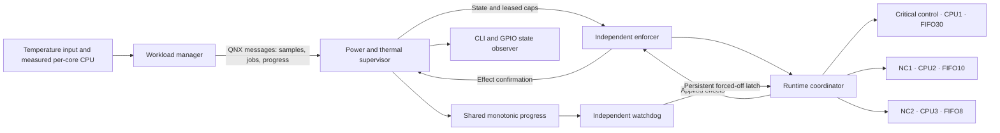

# PowerGuard

### Deterministic Power and Thermal-Budget Management for QNX Edge Systems

**Protect the control loop. Shed noncritical work. Restore only when it is safe.**

Team **Schedulix** · QNX eHACK National Finals · Problem **16** · **QNXHACK-HYD-014**

PowerGuard runs one critical-control process and two noncritical workloads on a
single QNX Raspberry Pi. When temperature, CPU utilization, estimated demand or
sensor integrity crosses a declared limit, it restricts **NC2 before NC1** while
leaving critical control running. Recovery uses lower thresholds, continuous
observation and **NC1-before-NC2** restoration.

**[Jury demo →](docs/jury-runbook.md)** · **[Requirements and answers →](docs/jury-checklist.md)** · **[Architecture and source →](docs/source-guide.md)** · **[Evidence →](docs/teammate3-merge-validation.md)** · **[Documentation →](docs/README.md)**

**Real sensor integration now Pi-tested:** 730 physical `/dev/thermal` readings
at 25 ms pulse releases; managed CPU restriction, stale-producer fail-safe and
staged recovery passed. **2,135 critical jobs, zero misses; 0.9865 ms maximum
response.** [Live demo, results and raw evidence →](docs/real-thermal-integration.md)

**Physical temperature-trip demo also passes:** an explicitly labelled
**56.5 / 57.0 / 57.5 °C** demo profile shows all five states, temperature-driven
restrictions and staged recovery with **4,118 critical jobs and zero misses**.
[Run the lower-temperature executable →](docs/low-temperature-demo.md)

## Results at a glance

Recorded on **Raspberry Pi 4B · QNX 8.0.0 · aarch64le release**. These are
archived measurements; this final documentation audit does not claim a new Pi run.

| Jury metric | Recorded result | Scope |
| --- | --- | --- |
| Limit detection → effective restriction | **13.820500 ms** worst effect; **14.798204 ms** worst supervisor receipt | 36 pre-watchdog restrictions; zero late or unconfirmed, against a 20 ms target |
| Critical-task deadline misses | **0 / 21,601** captured jobs; **1.148518 ms** maximum response | 10 ms period, 5 ms deadline; zero missing job records |
| Thermal / workload overshoot | **0.0 °C / 6 CPU percentage points / 2 demand-index points** | Observed 100 ms windows; temperature is simulated |
| State-transition jitter | **2.051 ms** Normal → Warning spread | Two matching trials; broader jitter qualification remains open |
| Controlled restoration | **3,057.061 ms** worst across 35 recoveries | Includes the declared 2 s + 1 s observation |

**Fault resilience:** 30/30 manager stalls confirmed within the 20 ms bound from
the unchanged 50 ms progress-expiry deadline; worst receipt **12.135167 ms**.
Ten manager restarts preserved complete job delivery. A separate supervisor-loss
test observed the persistent off latch by **235.188630 ms**, within its **270 ms**
bound. The deliberately stopped supervisor also caused a late IPC receipt;
that failure is retained in the [report](docs/teammate3-merge-validation.md).

The [machine-readable evidence](docs/validation/teammate3-merge-pi4-summary.json)
records timing origins, sample counts, binary hashes and retained failures.
**[Download the raw Pi evidence](docs/validation/pi4-integrated-evidence.zip)**:
21,601 critical jobs, telemetry, 30 stall receipts, restart logs, both scorecards
and watchdog proof, with a SHA-256 manifest. The [evidence guide](docs/validation/README.md)
shows how to reproduce the analysis.

## See it in one terminal

On the **prepared, previously qualified Pi**, from its deployed bundle:

```sh
cd /tmp/pg-t3-merge-2111
sh jury-demo.sh 1 2 3 4
```

The numbers are the four **verified procnto idle-thread IDs in CPU order** for
that image. Verify them again on another image or boot. The wrapper starts the
stack, waits for confirmed Normal, and records each run in `jury-evidence-<pid>/`.

| Menu | Demonstration | Expected behavior |
| --- | --- | --- |
| **1** | Live CLI | Temperature, source and age; per-core CPU; requested/applied caps; state and cause; critical latency, misses, job gaps and recovery progress |
| **2 → 5** | Real noncritical CPU spike → recovery | Restrict NC2 first; suspend both if Critical; restore progressively |
| **3 → 5** | Gradual simulated temperature ramp → recovery | Warning at 65 °C, Throttled at 70 °C, Critical at 75 °C |
| **4 → 5** | Frozen temperature input → fresh input | Age expires; conservative Critical with both noncritical workloads off; dwell before restoration |
| **6 → 7** | Manager stall → scorecard | Independent enforcer confirms restrictions while the manager remains stopped |
| **8 → 9** | Supervisor stall → new run | Watchdog latches noncritical work off; a fresh run is needed to requalify |
| **0** | Exit | Stops only processes started by this demo |

Show **7 before 8** to distinguish ordinary restriction scoring from the
separate supervisor-loss watchdog test. The [jury runbook](docs/jury-runbook.md)
includes a presentation script, deployment manifest and troubleshooting.

## How QNX makes the design work



- **Message-based control:** versioned QNX messages carry telemetry, decisions,
  job batches and effective acknowledgements. Commands and actual effects have
  separate timestamps.
- **High-resolution timing:** monotonic timer pulses and absolute worker
  releases track expiries without a busy polling supervisor. A 1 ns tolerance
  request is not a claim of 1 ns scheduling accuracy.
- **Priority and placement:** verified ThreadCtl affinity and FIFO priorities
  place critical control on CPU1 at priority 30; management runs on CPU0.
  Affinity is not a CPU reservation; OS and interrupt interference remain possible.
- **Independent protection:** the enforcer remains available during manager
  stalls. Shared progress lets the watchdog detect supervisor loss without
  waiting for the stopped supervisor to reply.
- **Auditable behavior:** complete critical-job records, first accepted effect
  receipts, freshness checks and five explicit policy states.

## Declared policy

Activation thresholds are inclusive upward; recovery limits are inclusive
downward. The highest active severity controls escalation. A previous
restriction is retained until recovery qualifies.

| Input | Recovery limit | Warning | Throttled | Critical |
| --- | ---: | ---: | ---: | ---: |
| Temperature (°C) | ≤ 62 | ≥ 65 | ≥ 70 | ≥ 75 |
| Busiest-core CPU (%) | ≤ 55 | ≥ 70 | ≥ 85 | ≥ 95 |
| Estimated demand index (0–100) | ≤ 45 | ≥ 60 | ≥ 75 | ≥ 90 |

| State | Noncritical capacity / exit condition |
| --- | --- |
| **Normal** | NC1 100%, NC2 100% |
| **Warning** | Full capacity if no earlier restriction is held; signal approaching limits |
| **Throttled** | NC1 100%, NC2 0% |
| **Critical** | NC1 0%, NC2 0%; critical control remains running |
| **Recovery** | Fresh, continuously clear conditions and acknowledged effects; from Critical, NC1 after 2 s, then NC2 after another 1 s. From Throttled, NC2 after 3 s |

The system **starts in Critical** until valid inputs, readiness and recovery
qualify. Temperature and CPU data expire at **150 ms**; manager progress and
worker grants have **50 ms** limits. Invalid or unavailable temperature causes
conservative Critical. Replaying a sample cannot refresh its acquisition time.
Recovery observation resets on unsafe input or an excessive acquisition gap
(**35 ms**). A watchdog latch requires a new run.

The default demand index is `(2 × requested NC1% + 3 × requested NC2%) / 5`,
using integer arithmetic. An explicit index is also supported. It is an estimate
of requested workload demand, **not measured watts**.

## Build and verify

Requires **QNX SDP 8**, its configured compiler environment and a qualified
four-core QNX Pi image. Momentics 8 users can import the existing project and
select `aarch64le-debug`.

```sh
make BUILD_PROFILE=release CCFLAGS='-Wextra -Werror'
make -C testbench
```

The root build produces the supervisor, runtime, enforcer, manager, CLI, thermal
monitor, LED observer and regression tools in `build/aarch64le-release/`.
Rebuild all bench-protocol-v4 components together. Deploy the files in the
[runbook manifest](docs/jury-runbook.md#build-and-prepare-another-copy); a fresh
clone does not include compiled binaries or an already running Pi stack.

For portable checks with a C11 compiler and Python 3 on Linux/macOS:

```sh
sh scripts/check-host.sh
```

These exercise policy, metrics, manager expiry, watchdog latching and
evidence-analysis rejection cases. They do not establish QNX scheduling or
hardware timing. See [tests](tests/README.md) for target validation.

For the verified real-temperature integration, see the [live thermal guide](docs/real-thermal-integration.md).
It connects the pulse reader to the managed runtime without mixing simulated
temperature into the policy stream. Run `validate-real-thermal.sh` from the
deployed release bundle to repeat its live acceptance sequence.

For the separate lower-temperature executable and bounded heating fixture,
build `make BUILD_PROFILE=release thermal-demo`; see its
[physical demonstration guide](docs/low-temperature-demo.md).

## Repository map

```text
PowerGuard/
├── src/             QNX supervisor service
├── supervisor/      Five-state policy and five-metric scorekeeper
├── runtime/         Coordinator, separate workers and independent enforcer
├── manager/         Telemetry, progress and complete critical-job forwarding
├── platform/        ThreadCtl qualification and shared watchdog progress
├── telemetry/       Real thermal reader and characterization instructions
├── gpio/            Five-state GPIO observer
├── include/         Policy, versioned IPC, metrics and platform contracts
├── tools/           CLI, readiness and live fault-check executables
├── testbench/       Scenario client and legacy threaded benchmark
├── tests/           Regressions, analyzers and archived evidence
├── scripts/         Jury demo, validation and optional remote-console tools
├── docs/            Jury checklist, architecture, runbooks and evidence summaries
├── Makefile         QNX application and regression builds
└── LICENSE          Licensing and attribution
```

Momentics metadata and `.launch` files remain at the root for IDE import.
The `.milestone-*` files support archived teammate benchmark builds and retain
their original paths. Generated `build/` and `results/` directories are ignored.
See the [scripts guide](scripts/README.md) before using historical remote menus.

## Demonstration scope and remaining qualification

The original jury menu uses **simulated temperature**, **real measured per-core
CPU**, and a **demand index**. The separate [real-sensor demo](docs/real-thermal-integration.md)
now verifies the integrated physical input path, CPU restriction, producer
freshness and recovery. Standard-profile thermal peak/cooldown qualification and physical
LED/wiring validation remain open. The required LED feature must therefore
not be described as hardware-verified. Pi 5/BSP qualification, larger matched
jitter trials, total split-stack overhead and long-duration interference tests
also remain open in the [qualification checklist](docs/threadctl-checklist.md).
Hardware power measurement and dynamic frequency control are optional stretch
goals. GPIO uses 3.3 V logic; verify board mapping and series resistors.

## Team and acknowledgements

**Team Schedulix · Vasavi College of Engineering, Hyderabad**

| Team member | Roll number |
| --- | --- |
| Abdul Aleem | 1602-23-735-001 |
| Kritika G | 1602-23-735-018 |
| Rishi N. | 1602-23-735-033 |

QNX provided us with an amazing platform to discover ourselves, explore
real-time systems, and turn our learning into PowerGuard. We are grateful for
the opportunity to build, test, and grow together.
