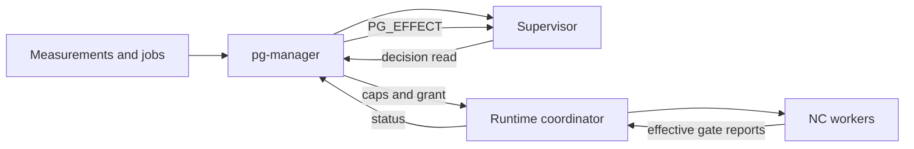
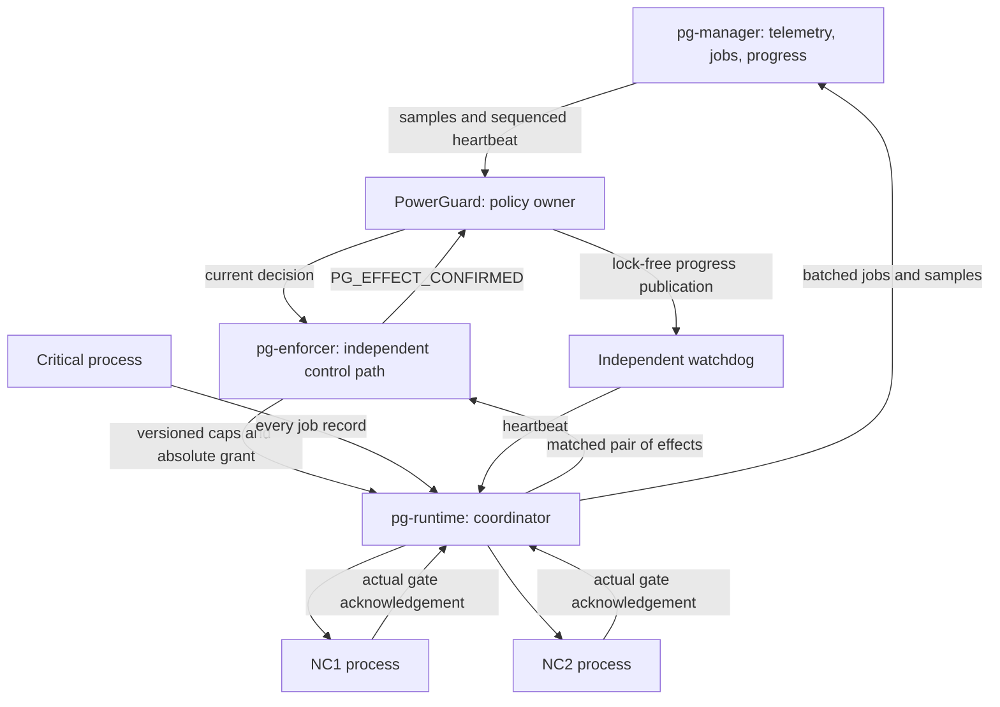
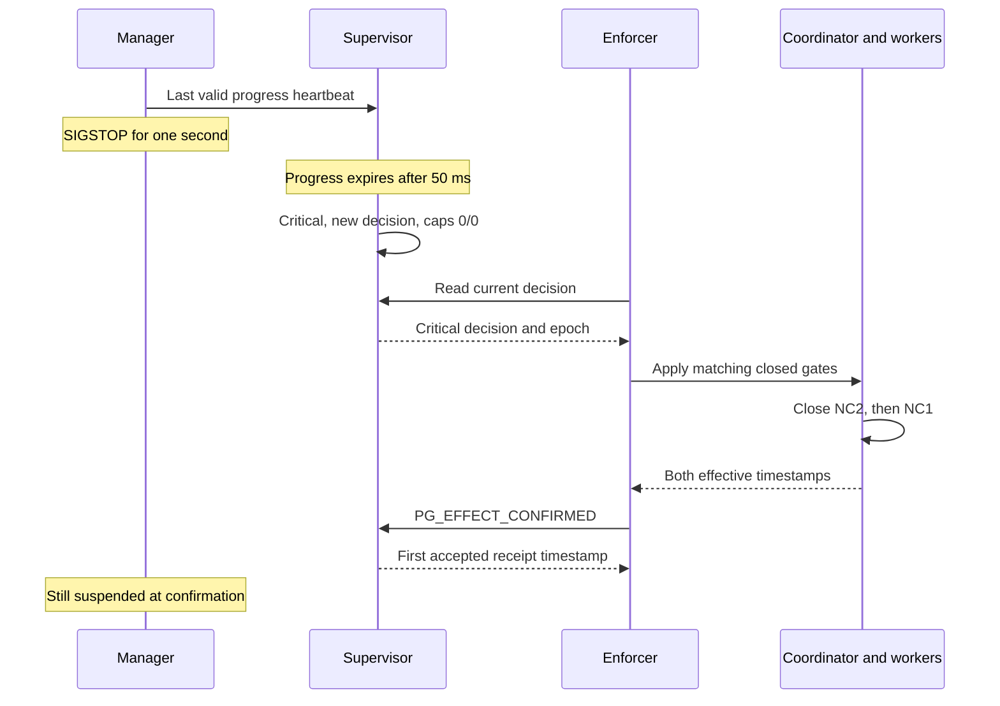

# PowerGuard architecture and manager stall fix

This guide explains the problem addressed by the ThreadCtl integration, the
manager-stall failure found on the Pi, the changes that corrected it, and the
evidence supporting the result. It describes the QNX 8 separate-process runtime.
The original `pgbench serve` threaded bench remains available for legacy tests;
it is not the qualified ThreadCtl runtime.

The corrected build passed 30 one-second manager-stall trials on the Raspberry
Pi. Worst manager-progress-expiry to supervisor confirmation was 11.653796 ms,
below the unchanged 20 ms target. Across the fault and nominal regressions,
all 37 restriction receipts were below 20 ms, and 22,394 archived critical
jobs had no deadline misses or record gaps.

## 1. Product requirement

One QNX Pi runs a critical-control workload and two noncritical workloads.
PowerGuard must detect excessive temperature, busiest-core utilization or
estimated demand, then reduce noncritical work in a declared order. It must
also become conservative when sensor data or management progress is invalid.

The central rules are:

- Keep critical control enabled at its declared priority and CPU placement.
- Restrict NC2 before NC1; restore NC1 before NC2.
- Distinguish a requested restriction from an acknowledged effective restriction.
- Restore capacity only after valid, continuously clear observations.
- Report incomplete evidence as incomplete; do not turn missing acknowledgements
  or job records into a passing measurement.

ThreadCtl provides CPU placement and thread-control facilities. It does not
reserve CPU time, enforce a workload percentage, set CPU frequency or establish
a measured watt saving. Worker execution gates enforce the workload caps.

## 2. What was wrong

### Initial implementation gaps

The initial testbench ran critical control, NC1 and NC2 as threads in one
process. It did not call ThreadCtl, so CPU placement was not established or
read back. Critical FIFO setup could fall back to ordinary scheduling. The
manager also copied process-wide CPU utilization into all four per-core fields.
That value could not establish genuine busiest-core utilization.

The integration added separate worker processes, verified affinity and FIFO
readiness, actual per-core idle-time accounting and complete job delivery.
Testing that stack then exposed an additional failure: the manager was still
required to get a restriction acknowledgement back to the supervisor.

### The manager was on both paths

Before the stall fix, `pg-manager` supplied telemetry and critical-job records,
forwarded supervisor caps, collected matching worker effects, and sent
`PG_EFFECT` back to the supervisor.



If the manager was suspended, neither its forwarding loop nor its confirmation
loop could execute. Workers could close locally when their old grants expired,
but that did not supply a matching confirmation for a new supervisor decision.
The supervisor checks the epoch, decision ID, both caps and effective timestamp;
an old generation's closed gate is not automatically proof of a new command.

Consequently, critical control could keep meeting deadlines while the
supervisor's restriction score still failed. The earlier fault-only run
reported a worst restriction score of 967.984 ms during a one-second service
pause. That is the earlier scorecard measurement, not a separately instrumented
first-receipt timestamp. The fix adds explicit first-receipt instrumentation,
so those two measurements should not be presented as identical metrics.

### Two other findings from Pi tests

First, the QNX image reported its idle threads at base priority 1. Assuming
idle priority 0 rejected valid counters. Qualification now checks the actual
thread name, CPU mapping and idle priority instead of relying on that assumption.

Second, a worker initially waited until its next period to report an applied
gate. Across two ordered workers, that added unnecessary delay and could reach
the supervisor's 20 ms acknowledgement timeout during restoration. Workers now
acknowledge at the completed-work boundary immediately after installing the gate.

## 3. Corrected process architecture

The supervisor remains the only owner of policy state. Telemetry and job
delivery are separated from command enforcement and effect reporting.



| Component | Responsibility | CPU | Base FIFO priority |
| --- | --- | ---: | ---: |
| `PowerGuard` | Policy, freshness deadlines, recovery and receipt acceptance | 0 | 25 in validated launch |
| `pg-enforcer` | Decision delivery and matching effect confirmation | 0 | 24 |
| `pg-manager` | Telemetry, critical-job delivery and progress heartbeat | 0 | 20 |
| `pg-runtime` coordinator | Worker identity, gate ordering, grants, CPU counters and job ring | 0 | 22 |
| `pg-runtime watchdog` | Read supervisor progress without IPC; latch off and pulse runtime heartbeat | 0 | 26 |
| Critical worker | Fixed critical computation and job timestamps | 1 | 30 |
| NC1 worker | Lower-criticality work and local grant enforcement | 2 | 10 |
| NC2 worker | Lowest-criticality work and local grant enforcement | 3 | 8 |
| `pg-thermal` | Optional standalone thermal characterization | 0 | 18 |

These are base priorities. QNX message-based priority inheritance may
temporarily raise a receiving service's effective priority. That is different
from changing its configured CPU affinity or base scheduling policy.

The enforcer registers with the coordinator. The coordinator checks its sender
PID, reported CPU, masks, FIFO policy, priority and thread name, accepts grants
only from that registered enforcer, and requires a current enforcer heartbeat
before allowing noncritical work. This is local application ownership checking,
not a security boundary against hostile code on the same system.

## 4. ThreadCtl integration

Each worker configures itself before reporting READY. The implementation uses:

| Interface | Purpose |
| --- | --- |
| `_NTO_TCTL_RUNMASK_GET_AND_SET_INHERIT` | Establish and read back current and child inheritance masks |
| `_NTO_TCTL_RUNMASK_GET_AND_SET_64` | Independently query the current mask using the recommended 64-bit representation |
| `_NTO_TCTL_NAME` | Set and verify recognizable thread names |
| `ThreadCtlExt(1, tid, _NTO_TCTL_NAME, ...)` | Read idle-thread names when qualifying procnto CPU counters |
| `pthread_setschedparam()` and `pthread_getschedparam()` | Establish and verify the declared FIFO configuration |

Runmasks must match clusters valid for the booted QNX system. The four-core
configuration uses single-CPU masks. A parent runmask alone is insufficient
to specify child placement; the inherit mask is configured as well. The
runtime does not try to change another process's affinity through ThreadCtlExt.
These choices follow the [QNX ThreadCtl reference](https://www.qnx.com/developers/docs/8.0/com.qnx.doc.neutrino.lib_ref/topic/t/threadctl.html)
and [affinity and inheritance guidance](https://www.qnx.com/developers/docs/8.0/com.qnx.doc.neutrino.prog/topic/multicore_processor_affinity.html).

Configuration failure exits visibly. Worker reports recheck placement during
execution; a reported fault or lost report withdraws noncritical permissions.
There is no ordinary-scheduling fallback in the separate-process runtime.

The diagnostic executable additionally tests direct runmask changes,
exchange/restoration, child-thread and spawned-process inheritance, invalid
masks, local hold/continue and exit-notification registration/cancellation.
Forced holds are exercised only on a disposable lock-free test thread. They
are not used to throttle production workers that might own application locks.

Affinity excludes our noncritical workers from CPU1. It does not exclude
unrelated processes, kernel threads, interrupts or shared-memory interference.
The measured deadline result is conditional on the recorded test configuration.

## 5. Independent manager progress and fault response

`pg-manager` sends `PG_MANAGER_HEARTBEAT` after successful progress through its
loop. A heartbeat carries the supervisor epoch, a monotonically increasing
sequence and a target monotonic progress timestamp.

The supervisor rejects wrong epochs, duplicate/older sequences, non-increasing
timestamps, future timestamps and progress that is already too old. Once the
progress guard is active, its deadline is:

```text
t_detect = last_manager_progress_ns + 50,000,000 ns
```

The guard becomes active on the first valid manager heartbeat. The supported
managed runtime uses one telemetry producer; do not bypass the manager with a
second live sample injector. The enforcer's effect heartbeat is tracked
separately and cannot renew manager progress.

When progress expires, `BAD_MANAGER` requires Critical and both noncritical
caps become zero. The supervisor schedules the progress expiry independently
of incoming manager messages. The enforcer continues reading decisions,
delivering caps and returning worker effects while the manager is stopped.



On resume, progress and measurements must become valid again. The original
clear observation and restoration dwell still apply; receipt of an effect
does not clear a manager fault or authorize immediate restoration.

A restarted manager cannot reset its sequence inside the existing epoch.
The teammate-3 integration now queries the supervisor's accepted source-job
cursor and progress sequence before continuing the existing run. Ten actual
manager restarts are covered by the new Pi regression. Lost/overwritten records
remain qualification failures. See [the integration report](teammate3-merge-validation.md)
for the nonblocking supervisor watchdog, persistent forced-off latch and latest
results. A watchdog trip requires restarting the complete run.

## 6. Gate enforcement and confirmation integrity

Noncritical workers run in bounded periods and check absolute grant expiry.
The burn loop is clipped to the grant's end. The coordinator issues NC1 closure
only after the required NC2 acknowledgement, and allows NC2 restoration only
after the required NC1 acknowledgement. Independent emergency lease expiry
closes each local gate; a stalled worker is never credited with an ACK it did
not send.

The effective pair is accepted only when epoch, decision ID, both caps and
timestamps match. The supervisor rejects future effects, effects before the
decision, mismatched caps, stale decisions and conflicting effective timestamps.

The worker's changed-gate ACK is sent immediately at a boundary after previous
work completes. Routine renewals preserve the original effective timestamp.

`PG_EFFECT_CONFIRMED` returns an expanded receipt for the new command type.
`PG_CONFIRM_READ` allows an independent test to inspect that receipt later.
Existing supervisor v1 request/reply layouts remain unchanged; these commands
are additive extensions. The expanded receipt contains the policy snapshot,
detection origin, first receipt, manager progress and restriction marker.

The first accepted receipt is immutable for its decision. A repeated heartbeat
cannot replace it with a later timestamp or make a late observation appear to
have been an earlier acknowledgement.

## 7. Timing definitions

All latency timestamps come from CLOCK_MONOTONIC on the same target.

| Symbol | Meaning |
| --- | --- |
| `t_progress` | Last accepted manager progress timestamp |
| `t_stop` | Test's SIGSTOP injection timestamp |
| `t_detect` | Qualifying limit or expiry timestamp; for manager faults, `t_progress + 50 ms` |
| `t_effect` | Later of the required matching worker effective timestamps |
| `t_received` | First accepted effect receipt at the supervisor |

```text
effect latency       = t_effect   - t_detect
confirmation latency = t_received - t_detect   <= 20 ms
injection latency    = t_received - t_stop
```

The timeout and the response bound were not increased to obtain a pass.
Worst measured manager-stall confirmation was 11.653796 ms after detection;
worst SIGSTOP-to-receipt was 61.251740 ms because it includes the 50 ms fault
detection interval. A claim of 20 ms from SIGSTOP would be incorrect.

CPU utilization uses a declared 100 ms sliding window refreshed every 10 ms.
CPU injection-to-detection includes that window. Temperature freshness is based
on the original acquisition timestamp, not the time a repeated value is received.

Coordinator timer pulses, worker releases and manager/enforcer waits request
1 ns timer tolerance. This requests high-resolution timing; it is not a claim
that scheduling or wakeup happens within 1 ns. Message waits are bounded through
[QNX TimerTimeout](https://www.qnx.com/developers/docs/8.0/com.qnx.doc.neutrino.lib_ref/topic/t/timertimeout.html).

## 8. Policy and critical-work configuration

| Signal | Warning | Throttled | Critical | Recovery ceiling |
| --- | ---: | ---: | ---: | ---: |
| Temperature | 65 C | 70 C | 75 C | 62 C |
| Busiest-core utilization | 70% | 85% | 95% | 55% |
| Estimated-demand index | 60 | 75 | 90 | 45 |

These are implementation settings requiring application/board qualification.
The demand index is not measured watts. Warning retains nominal caps;
Throttled stops NC2; Critical stops both noncritical workers. Recovery restores
NC1 before NC2 after the original two-second plus one-second observation stages.
The required clear conditions and valid acknowledgements remain in force.

Temperature and CPU maximum age are 150 ms. Worker grant, effect-path and
manager-progress timeouts are 50 ms; these are separate clocks despite having
the same configured value. The runtime's watchdog-heartbeat limit is 100 ms;
the separate supervisor-progress watchdog trips at 200 ms, checked every 50 ms.
Recovery allows
at most a 35 ms gap between qualifying observations.

The critical process executes 100,000 fixed volatile arithmetic iterations
every 10 ms against a 5 ms deadline in the validated release build. This
replaces a wall-time-duration burn with a declared amount of synthetic work.
Qualification of the eventual application control algorithm is still required.

Every reported job has a source ID, release, start, deadline and finish. A
2,048-record ring is drained in batches of 16. At 100 releases per second,
the ring retains approximately 20.48 seconds. Gaps or overwritten records fail
qualification. Continuous captures must start in time and keep up; missing
records are not reconstructed as passing jobs.

## 9. Pi validation and measured result

The target was `10.78.56.80`, reporting QNX 8.0.0, RaspberryPi4B and four CPUs.
Release builds used QNX SDP 8 GCC 12.2.0, `-O2`, extra warnings as errors and
compiler analysis. Debug builds also passed. Tests ran as root through the
QNX development service; deployment-account permissions remain unqualified.

| Test | Result |
| --- | --- |
| Manager suspended for one second | 30/30 distinct fault decisions confirmed before SIGCONT |
| Manager detection to supervisor confirmation | 6.477241 to 11.653796 ms |
| All restriction confirmations in final two captures | 37/37 within 20 ms; worst 12.856777 ms |
| Existing effect-based restriction score | 37 confirmed, 0 late/unconfirmed; worst 11.958 ms |
| Critical jobs across final captures | 22,394 archived; zero deadline misses or record gaps; worst response 1.179685 ms |
| Nominal ramp, spike, frozen input and staged recovery | All assertions passed |
| Watchdog suspension and recovery | Closure and recovery assertions passed |
| Restorations in final captures | 35, worst 3,057.432 ms including required dwell |
| ThreadCtl and policy assertions | Passed on Pi |
| Receipt audit negative cases | 4/4 host tests passed |

The fault run contains 32 restriction receipts: 30 manager-progress faults,
the watchdog fault and one additional restriction whose cause flags were clear
by receipt time. The nominal run contains five. All are included in the audit.

The stall capture archived 16,363 critical jobs and the nominal capture 6,031.
The nominal scorecard read contains 6,032 jobs because its endpoint differs
from the recorder's endpoint. Each archive is contiguous over its own interval;
the endpoint difference is not a missing-record claim.

The [published aggregate summary](validation/manager-stall-pi4-summary.json)
records the measured numbers and captured build hashes. The
[detailed validation report](manager-stall-fix-validation.md) identifies raw
capture locations. Raw result bundles and compiled binaries are excluded from
Git. Finite test results do not establish an unconditional worst-case bound.

## 10. Build, launch and reproduce

In a QNX SDP 8 development environment:

```sh
make all
make BUILD_PROFILE=release "CCFLAGS=-Wextra -Werror -fanalyzer"
make -C testbench
```

Build and deploy the whole updated bundle. Bench protocol is version 4, so old
operator clients, runtime and manager binaries must not be mixed with it.
Supervisor v1 message layouts remain compatible, but the new enforcer requires
the progress/confirmation extensions implemented here.

Copy these root-build binaries, `testbench/pgbench` and the script together:

The repository attributes preserve LF line endings for the target test script,
including when checking out on Windows. Transfer the script without converting
its line endings.

```text
PowerGuard pg-runtime pg-manager pg-enforcer pg-console
pg-check pg-manager-check pg-threadctl-check pg-validate pg-stall-check
pgbench validate-threadctl.sh
```

Inspect the image and confirm idle-thread identity first:

```sh
uname -a
pidin syspage=cluster
pidin -p 1 threads
```

The tested image uses idle TIDs 1, 2, 3 and 4 in CPU order, named `idle_cpu_0`
through `idle_cpu_3`, at base priority 1. Those values are verified at runtime;
do not assume the same mapping on another image.

An isolated manual launch is:

```sh
export PG_INSTANCE=threadctl_demo
./pg-runtime serve 1 2 3 4 100000 &
sleep 1
./pg-runtime watchdog &
./PowerGuard 25 &
sleep 1
./pg-enforcer &
./pg-manager &
```

Use the same PG_INSTANCE in operator terminals. Service-name instances do not
isolate physical CPUs. Do not start legacy `pgbench serve` under the same name
or publish a second sample stream into the managed session.

```sh
./pg-runtime status
./pg-console --live scores
./pgbench scenario spike
./pgbench scenario normal
```

For the automated runs used for the corrected build:

```sh
PG_TRIALS=0 PG_FULL_SCENARIOS=0 PG_STALL_TRIALS=30 PG_FAULT_TESTS=1 sh validate-threadctl.sh 1 2 3 4
PG_TRIALS=2 PG_FULL_SCENARIOS=1 PG_FAULT_TESTS=0 sh validate-threadctl.sh 1 2 3 4
```

The script creates its own instance, runs API/policy checks, starts its own
processes, captures raw data and performs assertions. Its manager-stall tool
checks the first supervisor receipt while SIGSTOP remains in effect, holds
the one-second fault, then resumes and verifies recovery. Cleanup targets its
own PIDs, resumes suspended test services and terminates the staged stack.

After retrieving a capture to the host:

```sh
python tests/analyze_manager_stalls.py CAPTURE/stall-confirmations.txt
python tests/analyze_threadctl.py CAPTURE/jobs.csv
python -m unittest discover -s tests -p test_manager_stall_analysis.py
```

The audit rejects a moved timing origin, a late receipt and repeated decision
IDs used as separate trials. Critical-job analysis checks IDs, timestamp order,
the declared release period and every captured deadline.

## 11. Troubleshooting and limits

| Symptom | Check and action |
| --- | --- |
| Enforcer missing or noncritical gates remain closed | Start the rebuilt pg-enforcer; inspect its READY report, registered PID and heartbeat |
| EPROTO or wrong reply layout | Rebuild and deploy every bench-protocol-v4 component together |
| Idle-clock startup rejection | Check TIDs, names, CPU mapping, permissions and image identity; do not substitute arbitrary thread clocks |
| FIFO/affinity/timer setup failure | Inspect required QNX abilities and valid CPU clusters; do not label a fallback run as qualified |
| BAD_MANAGER after restart | Check accepted-cursor/sequence recovery and source records; a watchdog FORCED_OFF latch requires a complete new run |
| Recovery takes longer than three seconds | Inspect source age, clear thresholds, sample gaps, manager progress and effective ACKs; uninterrupted dwell is required |
| Critical job overwrite or gap | Retain the failure, keep recorders running and inspect producer/consumer delays; do not report zero misses from an incomplete stream |
| Receipt or decision mismatch | Inspect epoch, decision ID, both caps and first accepted receipt; do not reuse an old ACK |

Temperature in the runtime's judging scenarios is explicitly SIMULATED, while
per-core CPU accounting is real. The earlier quiet onboard reader test collected
120/120 hardware reads without errors; it is not a qualified integrated thermal
control loop or a measured thermal-peak reduction. CPU overshoot was six
percentage points and estimated-index overshoot two points in the implemented
100 ms scoring window. Acceptable overshoot and jitter bounds remain to be frozen.

Current nominal transition-jitter regression has two matching trials; a new
full nominal 30-trial series with the independent enforcer is still pending.
Enforcer/worker/coordinator crash and hang tests, non-root abilities, physical
LED verification, real thermal conversion freshness and peak/cooldown evidence,
long-duration interference testing, total supervision overhead, a matched
affinity comparison and Pi 5 qualification also remain open.

Use the [current completion checklist](threadctl-checklist.md) for acceptance
status and the [integration guide](threadctl-integration.md) for focused operator
instructions. Hardware power metering and dynamic frequency control remain
optional stretch goals; this implementation does not claim either.

## 12. Source map

| File | Responsibility |
| --- | --- |
| `platform/threadctl.c`, `include/pg_threadctl.h` | CPU masks, inheritance, naming and scheduling verification |
| `runtime/runtime.c`, `runtime/protocol.h` | Coordinator, identity, ordered gates, CPU counters, job ring and watchdog mode |
| `runtime/worker.c` | Separate worker roles, fixed critical work, local lease enforcement and immediate ACKs |
| `runtime/enforcer.c` | Independent command/confirmation loop |
| `manager/pg-manager.c` | Samples, complete job batches and sequenced manager progress |
| `supervisor/policy.c`, `include/policy.h` | Policy, progress expiry, recovery and immutable first receipt |
| `src/PowerGuard.c`, `include/ipc.h` | QNX service dispatch and versioned progress/receipt messages |
| `tools/pg-stall-check.c`, `tools/pg-validate.c` | Live fault injection and target assertions |
| `tests/manager_checks.c`, `tests/threadctl_checks.c` | Policy/receipt and QNX API regression executables |
| `tests/analyze_manager_stalls.py`, `tests/analyze_threadctl.py` | Timestamp and job-stream audits |
| `scripts/validate-threadctl.sh` | Reproducible isolated Pi test orchestration |
